# Manual de usuario — KRONOS

Guía paso a paso para usar KRONOS. No hace falta saber de programación ni de finanzas: el software
va pidiendo los datos en orden y explica cada resultado.

---

## Índice

1. [Entrar al sistema](#1-entrar-al-sistema)
2. [Ver el caso de Espitia Barber Shop](#2-ver-el-caso-de-espitia-barber-shop)
3. [Crear un caso nuevo](#3-crear-un-caso-nuevo)
4. [Paso 1 · Información del negocio](#4-paso-1--información-del-negocio)
5. [Paso 2 · Catálogo de servicios](#5-paso-2--catálogo-de-servicios)
6. [Paso 3 · Inversión inicial](#6-paso-3--inversión-inicial)
7. [Paso 4 · Personal y costos](#7-paso-4--personal-y-costos)
8. [Paso 5 · Proyección de clientes](#8-paso-5--proyección-de-clientes)
9. [Paso 6 · Parámetros de evaluación](#9-paso-6--parámetros-de-evaluación)
10. [Ver el dashboard de resultados](#10-ver-el-dashboard-de-resultados)
11. [Comparar escenarios](#11-comparar-escenarios)
12. [Guardar y abrir un caso](#12-guardar-y-abrir-un-caso)
13. [Imprimir o guardar en PDF](#13-imprimir-o-guardar-en-pdf)
14. [Qué hacer si faltan datos](#14-qué-hacer-si-faltan-datos)
15. [Usar KRONOS desde el celular](#15-usar-kronos-desde-el-celular)

---

## 1. Entrar al sistema

Abra la dirección del despliegue en cualquier navegador. No hay que registrarse ni iniciar sesión:
KRONOS no pide usuario ni contraseña porque los datos se guardan en su propio navegador, no en un
servidor.

La pantalla de bienvenida explica en tres pasos qué hace la herramienta y ofrece dos caminos.

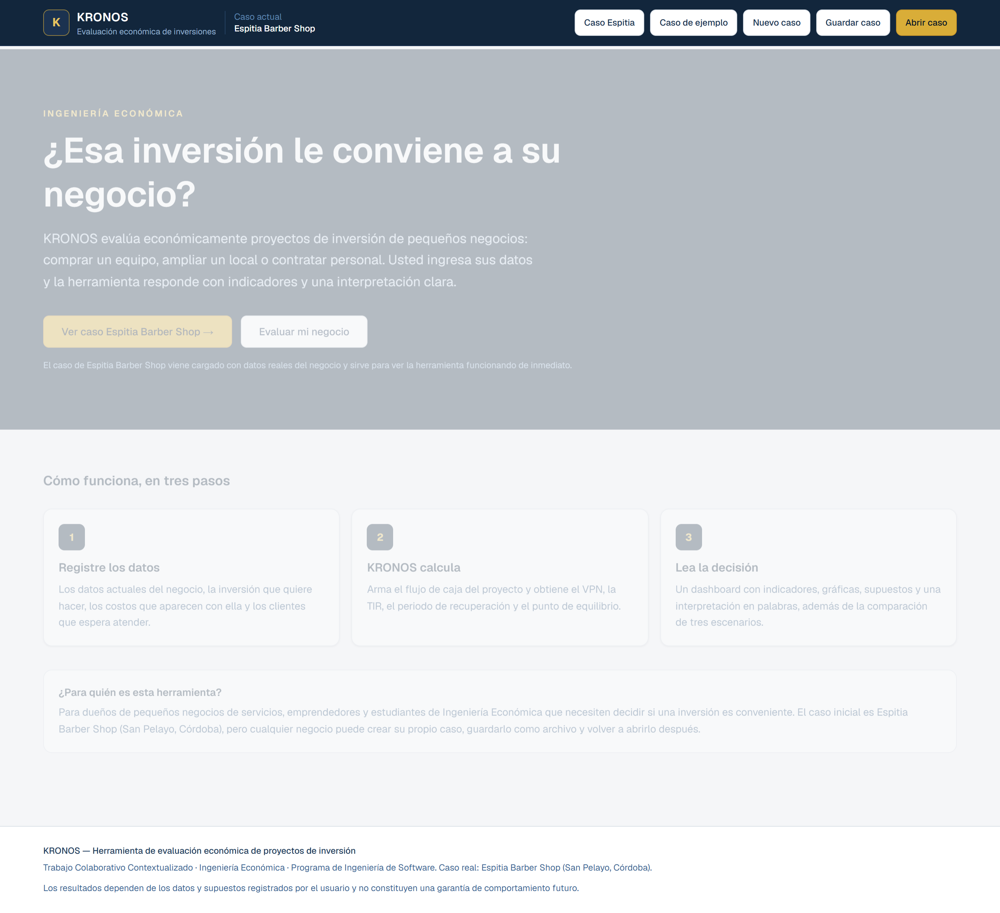

| Botón | Para qué sirve |
|---|---|
| **Ver caso Espitia Barber Shop →** | Carga el caso real ya resuelto y lleva directo al dashboard. Es la forma más rápida de ver la herramienta funcionando. |
| **Evaluar mi negocio** | Empieza un caso en blanco con sus propios datos. |

---

## 2. Ver el caso de Espitia Barber Shop

Pulse **Ver caso Espitia Barber Shop →**. KRONOS carga los datos reales del negocio y muestra de
inmediato el resultado de la evaluación.

Puede volver a este caso en cualquier momento con el botón **Caso Espitia** del encabezado.

> **Consejo para una demostración en vivo:** si abre KRONOS en un computador distinto al suyo, la
> aplicación no tendrá datos guardados. Pulse **Caso Espitia** y todo el caso queda cargado en un
> solo clic.

---

## 3. Crear un caso nuevo

Pulse **Nuevo caso** en el encabezado, o **Evaluar mi negocio** en la bienvenida. KRONOS pide
confirmación antes de borrar lo que tenga cargado.

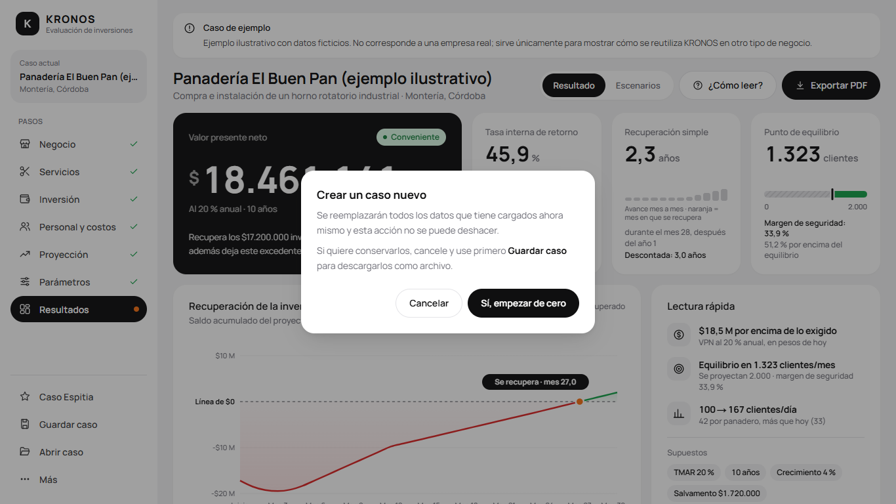

> Si quiere conservar el caso actual, cancele y use primero **Guardar caso** (ver
> [sección 12](#12-guardar-y-abrir-un-caso)).

Tras confirmar, empieza el recorrido por los seis pasos. Arriba siempre está la barra de pasos: se
puede avanzar con **Siguiente →**, retroceder con **← Anterior** o saltar a cualquier paso pulsando
su nombre. Un paso con un **«!» rojo** tiene datos pendientes.

---

## 4. Paso 1 · Información del negocio

Describe cómo opera el negocio **hoy**, antes de la inversión.

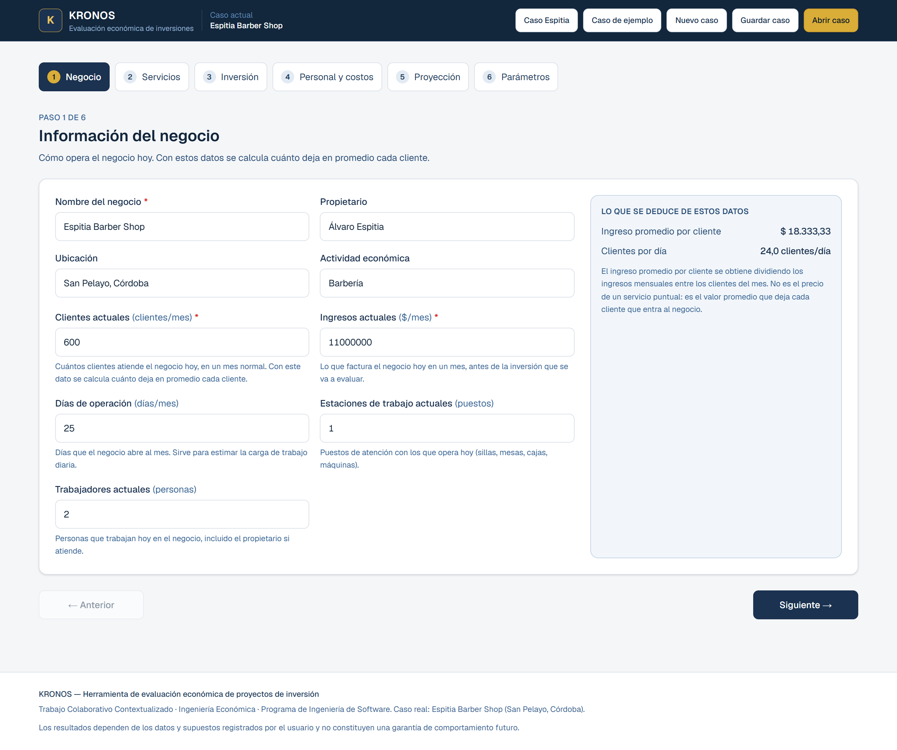

| Campo | Qué escribir |
|---|---|
| Nombre del negocio | Obligatorio. |
| Propietario, ubicación, actividad | Identifican el caso en el informe. |
| **Clientes actuales** (clientes/mes) | Obligatorio y mayor que 0. Cuántos clientes atiende en un mes normal. |
| **Ingresos actuales** ($/mes) | Obligatorio. Lo que factura hoy en un mes. |
| Días de operación (días/mes) | Días que abre al mes. |
| Estaciones de trabajo actuales | Puestos de atención con los que opera. |
| Trabajadores actuales | Personas que trabajan hoy, incluido el propietario si atiende. |

A la derecha, el panel **«Lo que se deduce de estos datos»** calcula en vivo el **ingreso promedio
por cliente** y los **clientes por día**. Si falta un dato, dice cuál falta en lugar de mostrar un
cero.

> El ingreso promedio por cliente es el valor promedio que deja cada cliente que entra al negocio.
> No es el precio de un servicio concreto.

---

## 5. Paso 2 · Catálogo de servicios

Registre los servicios que presta el negocio y sus precios, con **+ Agregar servicio**. Cada fila se
puede editar o eliminar.

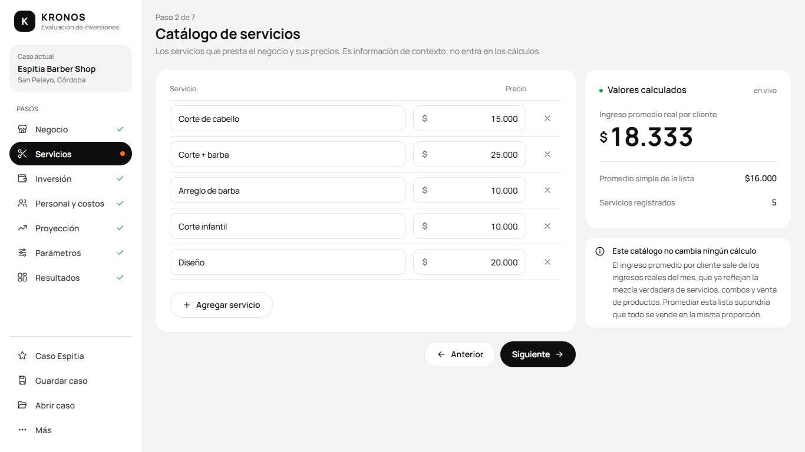

**Este paso es opcional y no cambia ningún cálculo.** Los servicios quedan registrados como
información del caso y aparecen entre los supuestos del dashboard, pero el ingreso promedio por
cliente se sigue calculando con los ingresos reales del mes, no promediando esta lista. La pantalla
explica por qué.

---

## 6. Paso 3 · Inversión inicial

Liste todo lo que hay que comprar, adecuar o instalar.

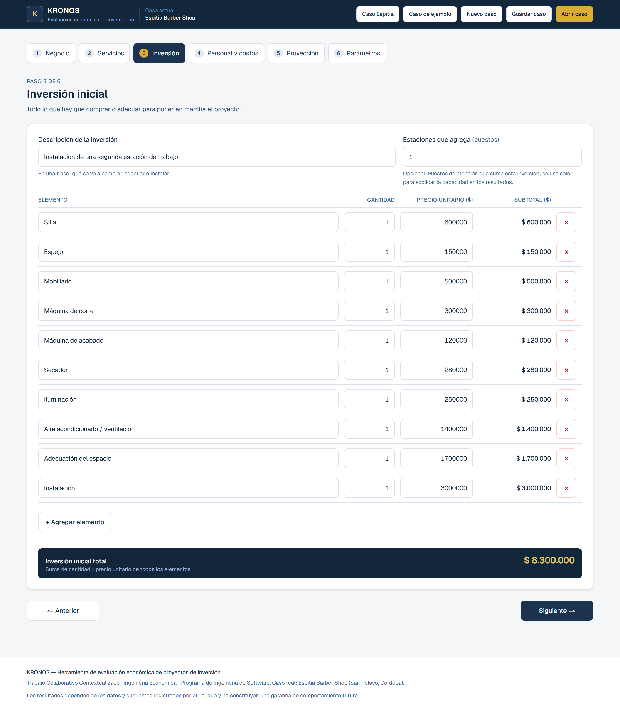

1. Escriba una **descripción** de la inversión en una frase.
2. Si la inversión agrega puestos de atención, indique cuántos en **Estaciones que agrega**. Es
   opcional y solo se usa para explicar la capacidad en los resultados.
3. Llene la tabla: **elemento**, **cantidad** y **precio unitario**. El **subtotal** se calcula solo.
4. Use **+ Agregar elemento** para añadir filas y el botón **×** para quitarlas.

La **inversión inicial total** aparece en la barra azul del final y se actualiza con cada cambio.

---

## 7. Paso 4 · Personal y costos

Aquí se registran los costos que **aparecen con la inversión**, no los que el negocio ya tiene.

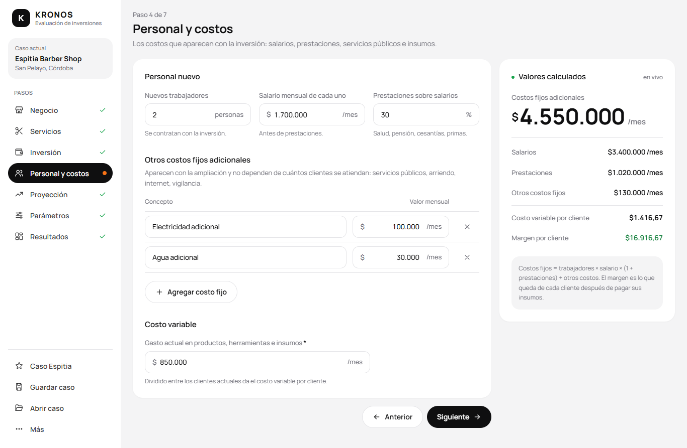

**Personal nuevo**

| Campo | Qué escribir |
|---|---|
| Nuevos trabajadores | Personas que se contratan con la inversión. |
| Salario mensual ($/mes c/u) | Salario de cada uno, antes de prestaciones. |
| Prestaciones (% sobre salarios) | Carga prestacional: salud, pensión, cesantías, primas. En Colombia suele estar cerca del 30 %. |

**Otros costos fijos adicionales**: servicios públicos adicionales, arriendo, internet, vigilancia…
Todo lo que se pague cada mes sin importar cuántos clientes entren. Se agregan y eliminan igual que
los elementos de la inversión.

**Costo variable**: el gasto actual en productos, herramientas e insumos ($/mes). Dividido entre los
clientes actuales da el **costo variable por cliente**.

El panel de la derecha muestra en vivo salarios, prestaciones, otros costos, el **costo fijo total**,
el costo variable y el **margen por cliente**, que es la pieza clave: lo que queda de cada cliente
adicional después de pagar sus insumos.

> Si el costo variable por cliente llega a ser mayor que el ingreso promedio, KRONOS lo advierte:
> cada cliente adicional generaría pérdida.

> **Importante si paga por comisión:** si los trabajadores se remuneran a comisión sobre lo que
> producen, ese valor **no va en el campo de salario** —que es un costo fijo—, sino sumado al gasto
> en insumos, que es el que alimenta el costo variable por cliente.

---

## 8. Paso 5 · Proyección de clientes

Indique cuántos clientes **adicionales** espera atender cada mes del primer año.

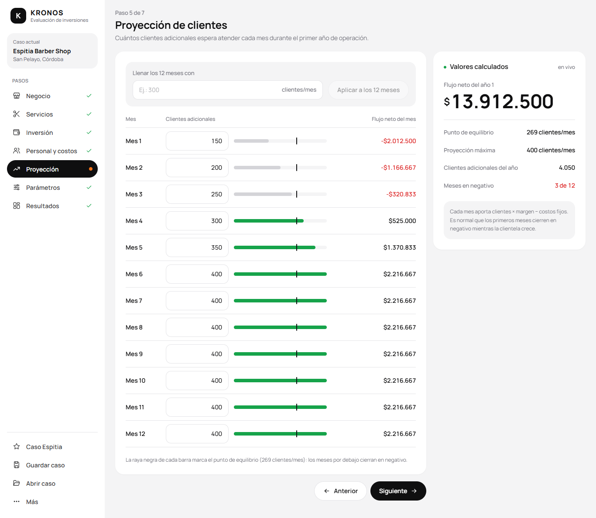

- Escriba el número de cada mes, o use **Llenar todos los meses con** y pulse **Aplicar a los 12
  meses** para poner el mismo valor en todos y ajustar después los que hagan falta.
- La columna **Flujo neto del mes** se calcula sola. Los meses **en rojo** son negativos: todavía no
  llegan al punto de equilibrio. Es normal al comienzo, mientras la clientela crece.
- La barra azul del final muestra el **flujo neto del año 1**.

El panel de la derecha muestra el **punto de equilibrio**: los clientes adicionales mínimos al mes
para cubrir los costos fijos. Compárelo con su proyección máxima.

---

## 9. Paso 6 · Parámetros de evaluación

Los supuestos con los que se evalúa el proyecto.

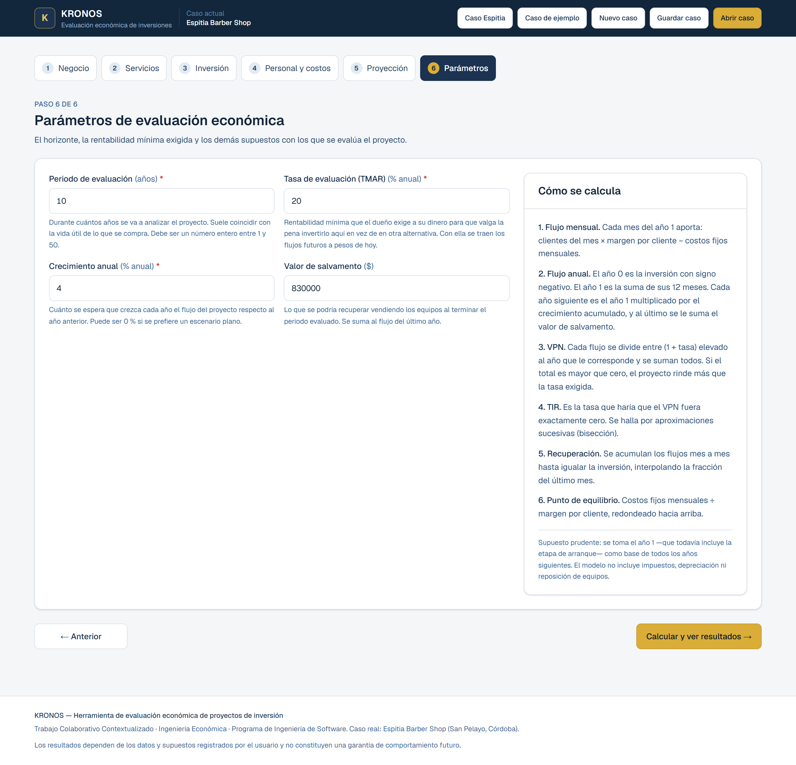

| Campo | Qué significa |
|---|---|
| **Periodo de evaluación** (años) | Durante cuántos años se analiza el proyecto. Entero, entre 1 y 50. |
| **Tasa de evaluación / TMAR** (% anual) | Rentabilidad mínima que usted le exige a su dinero para que valga la pena invertirlo aquí. |
| **Crecimiento anual** (% anual) | Cuánto crece el flujo cada año respecto al anterior. Puede ser 0 %. |
| **Valor de salvamento** ($) | Lo que se podría recuperar vendiendo los equipos al final. Se suma al último año. |

A la derecha, el recuadro **«Cómo se calcula»** explica en seis puntos el método completo.

Al terminar, pulse **Calcular y ver resultados →**.

---

## 10. Ver el dashboard de resultados

La primera vez aparece un recuadro que explica cómo leer el dashboard. Se cierra con **«Entendido,
no mostrar más»** y no vuelve a aparecer.

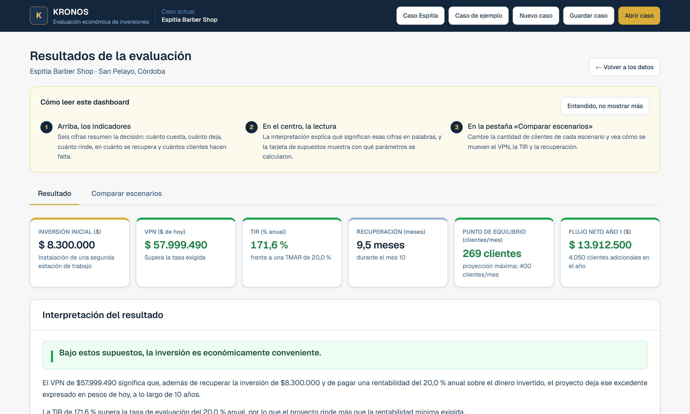

**Los seis indicadores de arriba**

| Indicador | Qué responde |
|---|---|
| **Inversión inicial** | Cuánto hay que poner. |
| **VPN** | Cuánto deja el proyecto en pesos de hoy, por encima de la rentabilidad exigida. En verde si es positivo, en rojo si es negativo. |
| **TIR** | A qué tasa rinde el dinero invertido, comparada con la TMAR. |
| **Recuperación** | En cuántos meses se devuelve la inversión. |
| **Punto de equilibrio** | Cuántos clientes adicionales al mes hacen falta como mínimo. |
| **Flujo neto año 1** | Cuánto deja el proyecto el primer año. |

**La interpretación del resultado** traduce esas cifras a palabras: qué significa el VPN, cómo se
compara la TIR con la tasa exigida, cuándo se recupera la inversión, cuánto margen de seguridad hay
sobre el punto de equilibrio y si la capacidad instalada alcanza para atender la proyección.

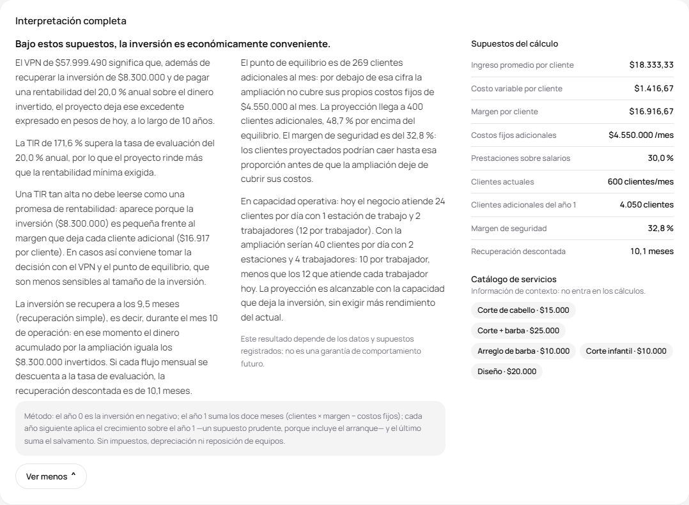

**Los supuestos del escenario** muestran todos los parámetros con los que se calculó, para que
cualquier lector sepa de dónde sale cada número.

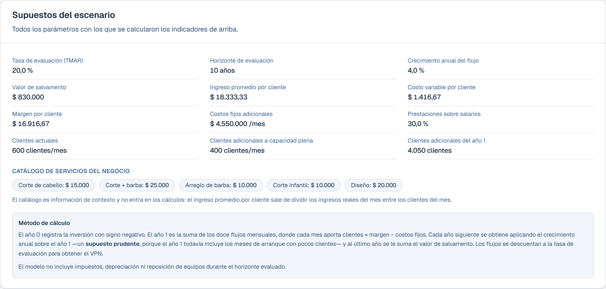

**Las cuatro gráficas**, cada una con una nota de cómo leerla:

1. Ingresos y costos adicionales por mes del año 1.
2. Flujo de caja por año — el año 0 en rojo es la inversión.
3. Clientes actuales y proyectados por mes, en barras apiladas.
4. Recuperación de la inversión: el saldo acumulado y el punto donde cruza $0.

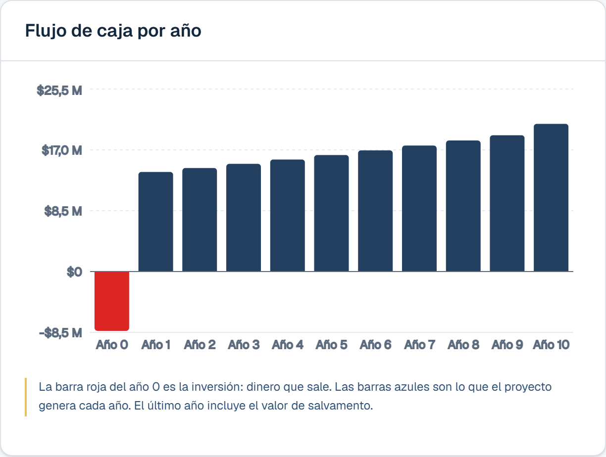

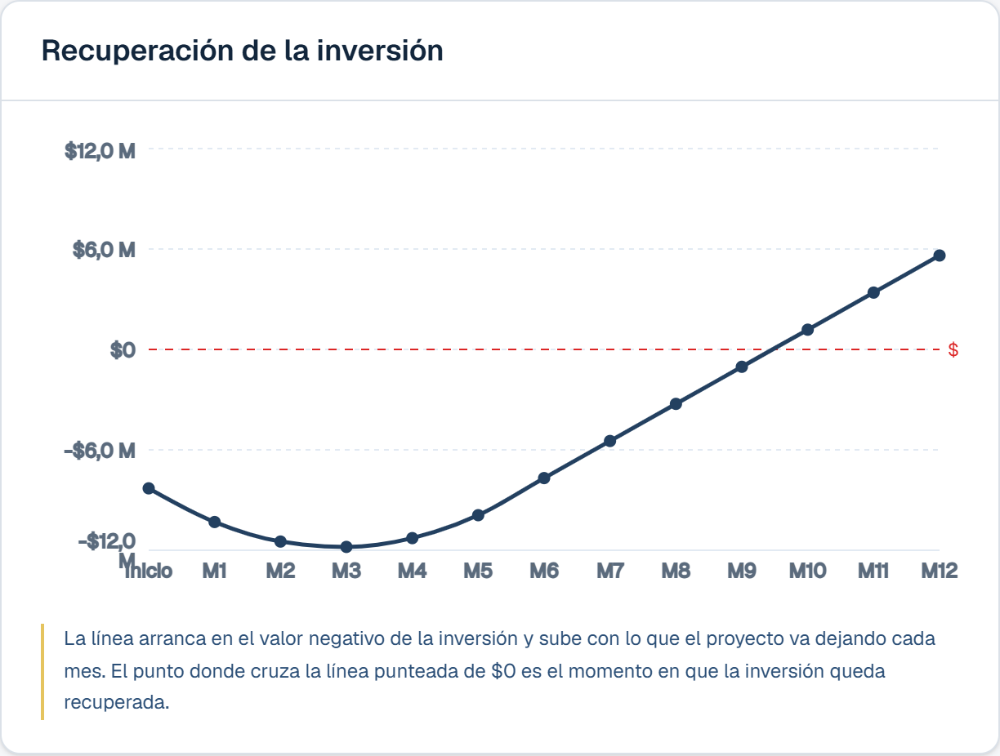

**La tabla de flujo de caja descontado** muestra, año por año, el flujo, el factor de descuento, el
valor presente y el acumulado. El pie cierra en el VPN.

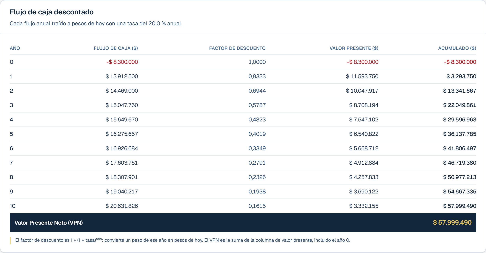

---

## 11. Comparar escenarios

Pulse la pestaña **Comparar escenarios**.

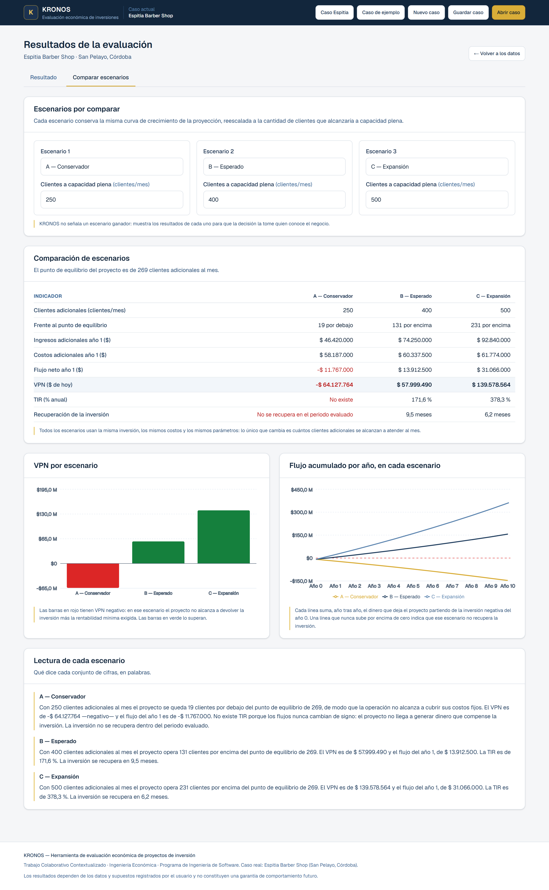

1. En los tres recuadros, escriba el **nombre** de cada escenario y los **clientes a capacidad
   plena** que alcanzaría el negocio en cada uno.
2. KRONOS conserva la misma curva de crecimiento de su proyección y la reescala a esa capacidad.
3. La tabla compara los indicadores de los tres escenarios lado a lado.

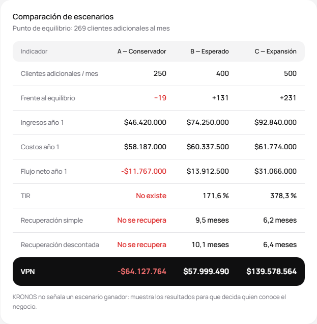

Debajo, dos gráficas —VPN por escenario y flujo acumulado por año— y una **lectura en palabras** de
cada uno.

> **KRONOS no señala un escenario ganador.** Muestra los resultados de cada uno para que la decisión
> la tome quien conoce el negocio.

Si un escenario queda por debajo del punto de equilibrio, su VPN será negativo, no se recuperará la
inversión y la TIR aparecerá como **«No existe»**: cuando todos los flujos del proyecto tienen el
mismo signo, la tasa interna de retorno no está definida matemáticamente. No es un error del
software.

---

## 12. Guardar y abrir un caso

KRONOS guarda automáticamente lo que usted escribe en el navegador que esté usando. Para llevarse el
caso a otro computador, compartirlo o archivarlo, use los botones del encabezado.

| Botón | Qué hace |
|---|---|
| **Guardar caso** | Descarga un archivo `.json` con todo el caso. |
| **Abrir caso** | Pide un archivo `.json` y carga ese caso. |
| **Caso Espitia** | Vuelve al caso real del TCC. Pide confirmación. |
| **Caso de ejemplo** | Carga un segundo caso de otro tipo de negocio. Pide confirmación. |
| **Nuevo caso** | Empieza de cero. Pide confirmación. |

Si el archivo no es un caso válido, KRONOS lo avisa:

> El archivo no es un caso de KRONOS válido. Use un archivo creado con el botón Guardar caso.

---

## 13. Imprimir o guardar en PDF

Al final de la pestaña **Resultado** está el botón **Imprimir o guardar en PDF**. Abre el diálogo de
impresión del navegador con una versión limpia del informe: sin encabezado, sin menús y sin botones,
con el nombre del caso arriba y las tarjetas sin partirse entre páginas.

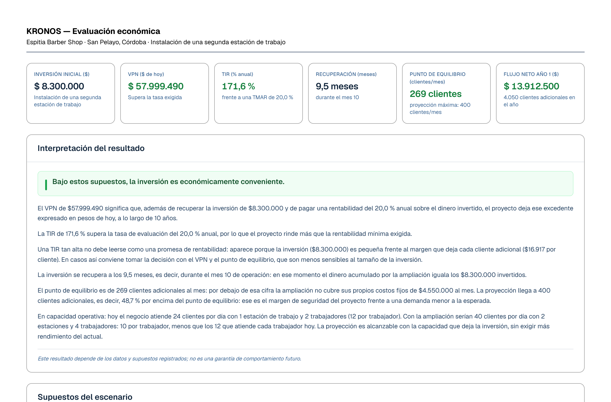

Para obtener un PDF, en el diálogo de impresión elija como destino **«Guardar como PDF»**.

---

## 14. Qué hacer si faltan datos

KRONOS **no calcula con datos incompletos**, porque un indicador construido sobre un dato que falta
induce a error. Si intenta ver los resultados sin haber llenado todo, aparece la lista de lo que
falta, agrupada por pantalla, con un botón **«Ir a corregir →»** que lleva directo al lugar exacto.

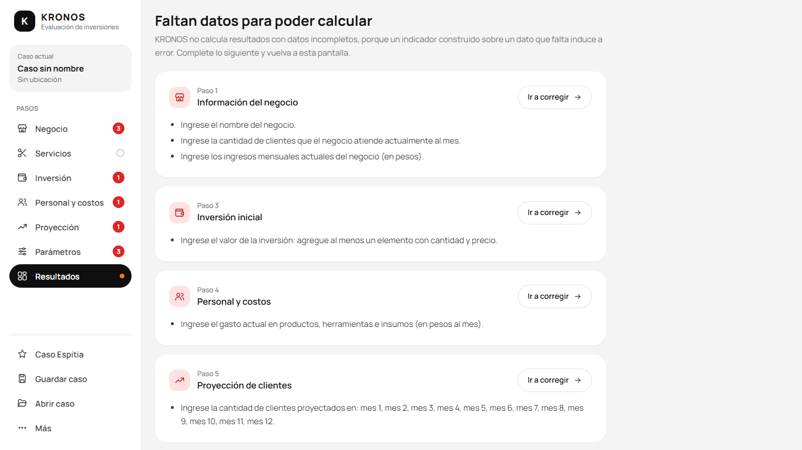

Los mensajes dicen qué falta y por qué hace falta. Por ejemplo:

> Los clientes actuales deben ser mayores que 0, porque con ellos se calcula el ingreso promedio por
> cliente.

---

## 15. Usar KRONOS desde el celular

KRONOS funciona igual en celular, tablet y computador. En pantallas pequeñas:

- Los indicadores se reorganizan en dos columnas.
- Las tablas editables se convierten en **tarjetas apiladas**, con el nombre de cada campo encima.
- La barra de pasos y la de botones se deslizan con el dedo, sin que la página se mueva de lado.
- Las tablas de resultados se deslizan dentro de su propio recuadro.

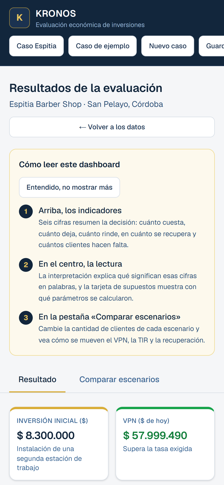

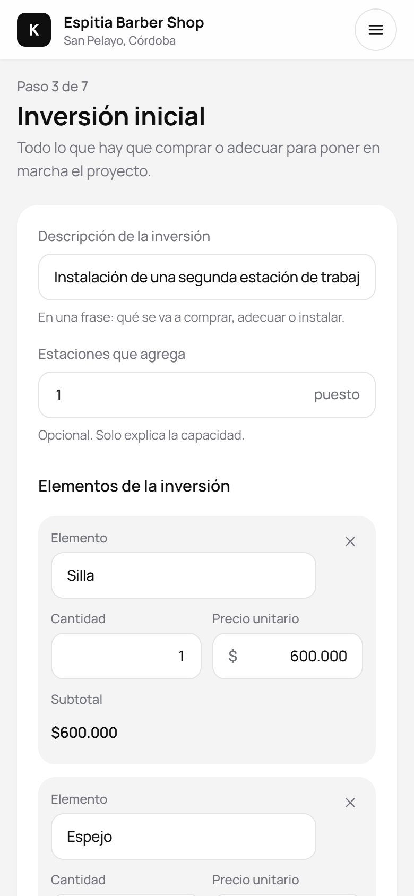
