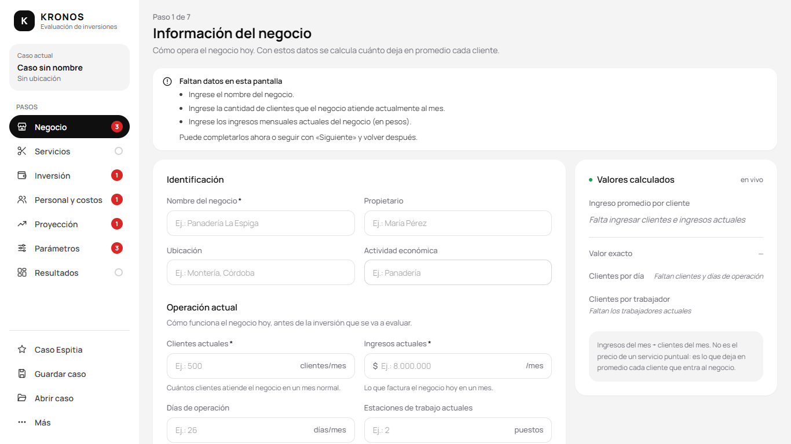
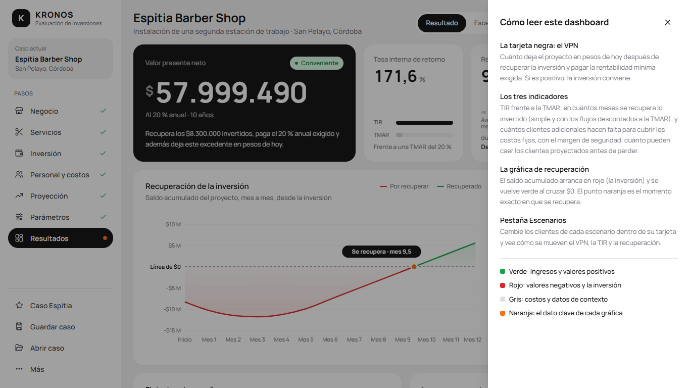
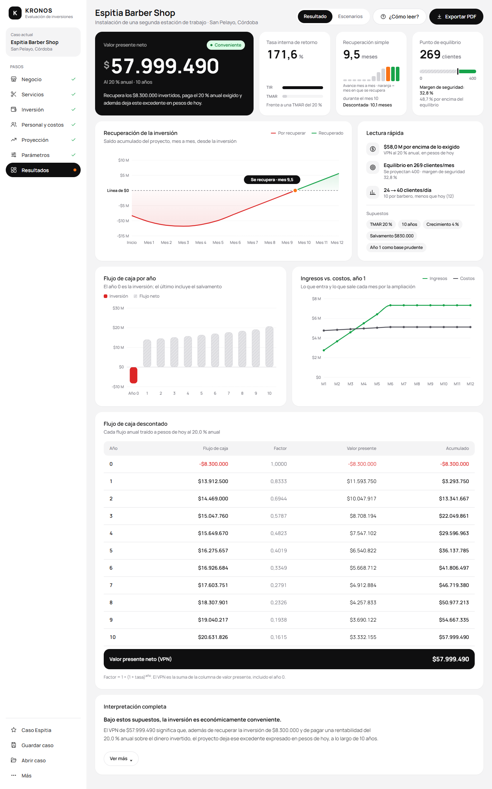
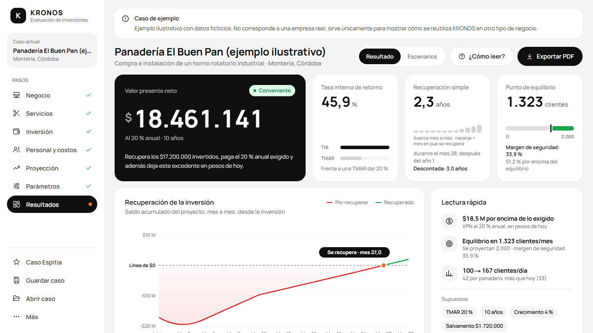
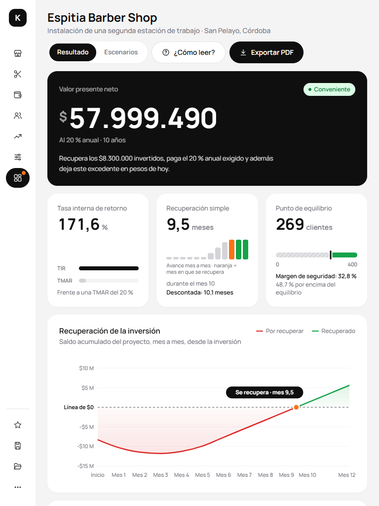

# Manual de usuario — KRONOS

Guía paso a paso para usar KRONOS. No hace falta saber de programación ni de finanzas: el software
va pidiendo los datos en orden y explica cada resultado.

---

## Índice

1. [Entrar al sistema](#1-entrar-al-sistema)
2. [Ver el caso de Espitia Barber Shop](#2-ver-el-caso-de-espitia-barber-shop)
3. [Crear un caso nuevo](#3-crear-un-caso-nuevo)
4. [Paso 1 · Información del negocio](#4-paso-1--información-del-negocio)
5. [Paso 2 · Catálogo de servicios](#5-paso-2--catálogo-de-servicios)
6. [Paso 3 · Inversión inicial](#6-paso-3--inversión-inicial)
7. [Paso 4 · Personal y costos](#7-paso-4--personal-y-costos)
8. [Paso 5 · Proyección de clientes](#8-paso-5--proyección-de-clientes)
9. [Paso 6 · Parámetros de evaluación](#9-paso-6--parámetros-de-evaluación)
10. [Ver el dashboard de resultados](#10-ver-el-dashboard-de-resultados)
11. [Comparar escenarios](#11-comparar-escenarios)
12. [Guardar y abrir un caso](#12-guardar-y-abrir-un-caso)
13. [Exportar a PDF](#13-exportar-a-pdf)
14. [Qué hacer si faltan datos](#14-qué-hacer-si-faltan-datos)
15. [Usar KRONOS desde el celular](#15-usar-kronos-desde-el-celular)

---

## 1. Entrar al sistema

Abra la dirección del despliegue en cualquier navegador. No hay que registrarse ni iniciar sesión:
KRONOS no pide usuario ni contraseña porque los datos se guardan en su propio navegador, no en un
servidor.

La pantalla de bienvenida hace la pregunta central —«¿Esa inversión le conviene a su negocio?»—,
muestra a la derecha una vista previa real del resultado del caso Espitia y, debajo, los tres pasos
del proceso. Ofrece dos caminos:

| Botón | Para qué sirve |
|---|---|
| **Ver caso Espitia Barber Shop** (botón negro) | Carga el caso real ya resuelto y lleva directo al dashboard. Es la forma más rápida de ver la herramienta funcionando. |
| **Evaluar mi negocio** (enlace) | Empieza un caso en blanco con sus propios datos. |

### El menú lateral

Fuera de la bienvenida, todas las pantallas tienen un **menú lateral** fijo a la izquierda con:

- el **caso actual**, con su nombre y ubicación;
- los **7 pasos** —Negocio, Servicios, Inversión, Personal y costos, Proyección, Parámetros y
  Resultados—, cada uno con su estado:

  | Marca | Significa |
  |---|---|
  | ✓ verde | El paso está completo. |
  | Círculo gris | Pendiente: todavía no se ha llenado. En Servicios, que es opcional, indica que no hay ningún servicio registrado. |
  | Número en rojo | Cuántos datos faltan. Solo aparece después de intentar avanzar con **Siguiente** o de entrar a Resultados. |
  | Fondo negro y punto naranja | Es el paso en el que usted está. |

- abajo, las acciones del caso: **Caso Espitia**, **Guardar caso**, **Abrir caso** y el menú
  **Más**, con **Caso de ejemplo** y **Nuevo caso**.

En tablet el menú se reduce a solo íconos, y en celular se abre con el botón ☰ de la barra superior.

---

## 2. Ver el caso de Espitia Barber Shop

Pulse **Ver caso Espitia Barber Shop**. KRONOS carga los datos reales del negocio y muestra de
inmediato el resultado de la evaluación.

Puede volver a este caso en cualquier momento con **Caso Espitia** en el menú lateral.

> **Consejo para una demostración en vivo:** si abre KRONOS en un computador distinto al suyo, la
> aplicación no tendrá datos guardados. Pulse **Caso Espitia** y todo el caso queda cargado en un
> solo clic.

---

## 3. Crear un caso nuevo

Pulse **Más → Nuevo caso** en el menú lateral, o **Evaluar mi negocio** en la bienvenida. Si hay
datos propios cargados, KRONOS pide confirmación antes de borrarlos. Desde la bienvenida no la pide
cuando lo cargado es el caso Espitia original o un caso vacío, porque no hay nada que perder.

> Si quiere conservar el caso actual, cancele y use primero **Guardar caso** (ver
> [sección 12](#12-guardar-y-abrir-un-caso)).

Tras confirmar empieza el recorrido por los seis pasos de datos. Todos aparecen como **pendientes**
(círculo gris) y los campos vacíos muestran ejemplos genéricos («Ej.: Panadería La Espiga»), que no
son datos reales.

Cada pantalla tiene el formulario a la izquierda, la tarjeta **«Valores calculados»** a la derecha
—se actualiza mientras usted escribe— y los botones **Anterior** y **Siguiente** abajo. También
puede saltar a cualquier paso desde el menú lateral.

Si pulsa **Siguiente** con datos obligatorios vacíos, KRONOS no avanza: muestra el recuadro
**«Faltan datos en esta pantalla»** y marca el paso en rojo en el menú. Si vuelve a pulsar
**Siguiente**, avanza de todas formas y usted puede completar ese paso después.

**Cómo se escriben los números.** Los campos de dinero y de cantidades muestran los puntos de miles
mientras escribe (11.000.000) y llevan el signo **$** dentro del campo, a la izquierda. La unidad va
dentro del campo, a la derecha (clientes/mes, %, años…), en singular o plural según el valor
(«1 puesto», «2 puestos»).

---

## 4. Paso 1 · Información del negocio

Describe cómo opera el negocio **hoy**, antes de la inversión.

| Campo | Qué escribir |
|---|---|
| Nombre del negocio | Obligatorio. |
| Propietario, ubicación, actividad | Identifican el caso en el informe. |
| **Clientes actuales** (clientes/mes) | Obligatorio y mayor que 0. Cuántos clientes atiende en un mes normal. |
| **Ingresos actuales** ($/mes) | Obligatorio. Lo que factura hoy en un mes. |
| Días de operación (días/mes) | Días que abre al mes. |
| Estaciones de trabajo actuales (puestos) | Puestos de atención con los que opera. |
| Trabajadores actuales (personas) | Personas que trabajan hoy, incluido el propietario si atiende. |

A la derecha, la tarjeta **«Valores calculados»** muestra en grande el **ingreso promedio por
cliente** y, debajo, los **clientes por día** y por trabajador. Si falta un dato, dice cuál falta en
lugar de mostrar un cero.

> El ingreso promedio por cliente es el valor promedio que deja cada cliente que entra al negocio.
> No es el precio de un servicio concreto.

---

## 5. Paso 2 · Catálogo de servicios

Registre los servicios que presta el negocio y sus precios con **+ Agregar servicio**. Cada fila se
puede editar, o eliminar con su **X**.

**Este paso es opcional y no cambia ningún cálculo.** Los servicios quedan registrados como
información del caso y aparecen en la interpretación del dashboard, pero el ingreso promedio por
cliente se sigue calculando con los ingresos reales del mes, no promediando esta lista. La pantalla
explica por qué.

Solo cuentan los servicios con nombre y precio: las filas vacías se ignoran. Si no hay ninguno, el
paso queda como pendiente, no como error.

---

## 6. Paso 3 · Inversión inicial

Liste todo lo que hay que comprar, adecuar o instalar.

1. Escriba una **descripción** de la inversión en una frase.
2. Si la inversión agrega puestos de atención, indique cuántos en **Estaciones que agrega**. Es
   opcional y solo se usa para explicar la capacidad en los resultados.
3. Llene la tabla: **elemento**, **cantidad** y **precio unitario**. El **subtotal** se calcula solo.
4. Use **+ Agregar elemento** para añadir filas y la **X** de cada fila para quitarlas.

La **inversión inicial total** aparece en grande en la tarjeta «Valores calculados», junto con el
elemento de mayor peso, y se actualiza con cada cambio.

---

## 7. Paso 4 · Personal y costos

Aquí se registran los costos que **aparecen con la inversión**, no los que el negocio ya tiene.

**Personal nuevo**

| Campo | Qué escribir |
|---|---|
| Nuevos trabajadores (personas) | Personas que se contratan con la inversión. |
| Salario mensual de cada uno ($/mes) | Salario de cada uno, antes de prestaciones. |
| Prestaciones sobre salarios (%) | Carga prestacional: salud, pensión, cesantías, primas. En Colombia suele estar cerca del 30 %. |

**Otros costos fijos adicionales**: servicios públicos adicionales, arriendo, internet, vigilancia…
Todo lo que se pague cada mes sin importar cuántos clientes entren. Se agregan y eliminan igual que
los elementos de la inversión.

**Costo variable**: el gasto actual en productos, herramientas e insumos ($/mes). Dividido entre los
clientes actuales da el **costo variable por cliente**.

La tarjeta «Valores calculados» muestra en grande los **costos fijos adicionales** al mes y, debajo,
salarios, prestaciones, otros costos, el costo variable y el **margen por cliente**, que es la pieza
clave: lo que queda de cada cliente adicional después de pagar sus insumos.

> Si el costo variable por cliente llega a ser mayor que el ingreso promedio, KRONOS lo advierte:
> cada cliente adicional generaría pérdida.

> **Importante si paga por comisión:** si los trabajadores se remuneran a comisión sobre lo que
> producen, ese valor **no va en el campo de salario** —que es un costo fijo—, sino sumado al gasto
> en insumos, que es el que alimenta el costo variable por cliente.

---

## 8. Paso 5 · Proyección de clientes

Indique cuántos clientes **adicionales** espera atender cada mes del primer año.

- Escriba el número de cada mes, o use **Llenar los 12 meses con** y pulse **Aplicar a los 12
  meses** para poner el mismo valor en todos y ajustar después los que hagan falta.
- La columna **Flujo neto del mes** se calcula sola. Los meses **en rojo** son negativos: todavía no
  llegan al punto de equilibrio. Es normal al comienzo, mientras la clientela crece.
- La barra delgada de cada mes compara sus clientes con el punto de equilibrio, marcado con una
  **raya negra**: gris si el mes queda por debajo, verde si lo supera.

La tarjeta «Valores calculados» muestra en grande el **flujo neto del año 1** y, debajo, el **punto
de equilibrio**, la proyección máxima y cuántos meses quedan en negativo.

---

## 9. Paso 6 · Parámetros de evaluación

Los supuestos con los que se evalúa el proyecto.

| Campo | Qué significa |
|---|---|
| **Periodo de evaluación** (años) | Durante cuántos años se analiza el proyecto. Entero, entre 1 y 50. |
| **Tasa de evaluación / TMAR** (% anual) | Rentabilidad mínima que usted le exige a su dinero para que valga la pena invertirlo aquí. |
| **Crecimiento anual** (% anual) | Cuánto crece el flujo cada año respecto al anterior. Puede ser 0 %. |
| **Valor de salvamento** ($) | Lo que se podría recuperar vendiendo los equipos al final. Se suma al último año. |

A la derecha, la tarjeta «Valores calculados» muestra el **VPN**, la **TIR** y la **recuperación
simple** que resultan de los parámetros mientras los escribe, si los pasos anteriores están
completos. El desplegable **«Cómo se calcula»** explica el método en seis puntos.

Al terminar, pulse **Ver resultados**.

---

## 10. Ver el dashboard de resultados

Arriba a la derecha están el selector **Resultado | Escenarios**, el botón **¿Cómo leer?** y el
botón negro **Exportar PDF**. En un computador, las dos primeras filas del dashboard caben en la
pantalla sin desplazarse.

**¿Cómo leer?** abre un panel desde la derecha con la explicación de cada parte y del significado de
los colores (verde: ingresos y valores positivos; rojo: valores negativos y la inversión; gris:
costos y datos de contexto; naranja: el dato clave de cada gráfica). Se cierra con la X, con Esc o
con un clic fuera del panel.

**Primera fila: la decisión**

| Tarjeta | Qué responde |
|---|---|
| **Valor presente neto** (tarjeta negra) | Cuánto deja el proyecto en pesos de hoy, por encima de la rentabilidad exigida. El chip dice **Conveniente** (verde) si es positivo o **No conveniente** (rojo) si es negativo. |
| **Tasa interna de retorno** | A qué tasa rinde el dinero invertido. Las dos barras la comparan con la TMAR. |
| **Recuperación simple** | En cuántos meses se devuelve la inversión. Las 12 mini barras muestran el avance mes a mes del año 1; la **naranja** es el mes en que se recupera. Debajo aparece la **recuperación descontada**, que trae cada flujo mensual a pesos de hoy con la TMAR antes de sumarlo. |
| **Punto de equilibrio** | Cuántos clientes adicionales al mes hacen falta como mínimo. La barra llega hasta la proyección y la raya negra marca el equilibrio. Debajo aparece el **margen de seguridad**: (clientes proyectados − equilibrio) ÷ clientes proyectados, es decir, cuánto pueden caer los clientes antes de que la ampliación deje de cubrir sus costos. También se indica cuánto supera la proyección al equilibrio, que es otro dato. |

**Segunda fila: la recuperación y la lectura rápida**

La gráfica **Recuperación de la inversión** muestra el saldo acumulado mes a mes: en rojo mientras
la inversión no se ha recuperado y en verde después. El punto naranja, con la etiqueta «Se recupera
· mes 9,5», marca el momento exacto en que el saldo cruza la **línea de $0**.

La tarjeta **Lectura rápida** resume la decisión en tres líneas —VPN, punto de equilibrio con su
margen de seguridad y capacidad— y muestra los **supuestos** del cálculo como etiquetas: TMAR,
horizonte, crecimiento, salvamento y el año 1 como base prudente.

**Más abajo**

- **Flujo de caja por año**: el año 0 en rojo es la inversión; los años siguientes, en gris rayado.
- **Ingresos vs. costos, año 1**: los ingresos en verde y los costos en gris oscuro, mes a mes.

- **Flujo de caja descontado**: año por año, el flujo, el factor de descuento, el valor presente y
  el acumulado. La franja negra del final muestra el VPN.

- **Interpretación completa**: el titular y el primer párrafo, siempre a la vista. **Ver más**
  despliega la lectura completa —qué significa el VPN, la TIR frente a la TMAR, las dos
  recuperaciones, el equilibrio con su margen de seguridad y la capacidad operativa— y, a la
  derecha, los **supuestos del cálculo**, el catálogo de servicios y el método.

El dashboard completo, de arriba abajo:

---

## 11. Comparar escenarios

Pulse **Escenarios** en el selector de arriba.

1. Cada escenario tiene su tarjeta: nombre (editable), chip **Conveniente** o **No conveniente**,
   VPN, TIR, recuperación simple y una barra que compara sus clientes con el punto de equilibrio,
   marcado con una raya negra.
2. Escriba en cada tarjeta los **clientes a capacidad plena** que alcanzaría el negocio. KRONOS
   conserva la misma curva de crecimiento de su proyección y la reescala a esa capacidad.
3. Debajo están la gráfica **VPN por escenario** —el escenario base en negro, los demás en gris y
   los negativos en rojo— y la **tabla comparativa**, que incluye la recuperación simple y la
   descontada.

> **KRONOS no señala un escenario ganador.** Muestra los resultados de cada uno para que la decisión
> la tome quien conoce el negocio.

Si un escenario queda por debajo del punto de equilibrio, su VPN será negativo, no se recuperará la
inversión y la TIR aparecerá como **«No existe»**: cuando todos los flujos del proyecto tienen el
mismo signo, la tasa interna de retorno no está definida matemáticamente. No es un error del
software.

---

## 12. Guardar y abrir un caso

KRONOS guarda automáticamente lo que usted escribe en el navegador que esté usando. Para llevarse el
caso a otro computador, compartirlo o archivarlo, use las acciones de la parte baja del menú
lateral.

| Botón | Qué hace |
|---|---|
| **Guardar caso** | Descarga un archivo `.json` con todo el caso. |
| **Abrir caso** | Pide un archivo `.json` y carga ese caso. |
| **Caso Espitia** | Vuelve al caso real del TCC. Pide confirmación. |
| **Más → Caso de ejemplo** | Carga un segundo caso de otro tipo de negocio: una panadería ilustrativa. Pide confirmación. |
| **Más → Nuevo caso** | Empieza de cero. Pide confirmación. |

Si el archivo no es un caso válido, KRONOS lo avisa:

> El archivo no es un caso de KRONOS válido. Use un archivo creado con el botón Guardar caso.

---

## 13. Exportar a PDF

Pulse **Exportar PDF**, arriba a la derecha del dashboard. Se abre el diálogo de impresión del
navegador con una versión limpia del informe: sin menú lateral ni botones, con el nombre del caso
arriba, la interpretación completa desplegada y las tarjetas sin partirse entre páginas.

Para obtener el PDF, en el diálogo de impresión elija como destino **«Guardar como PDF»**.

---

## 14. Qué hacer si faltan datos

KRONOS **no calcula con datos incompletos**, porque un indicador construido sobre un dato que falta
induce a error. Si intenta ver los resultados sin haber llenado todo, aparece la lista de lo que
falta, agrupada por pantalla, con un botón **«Ir a corregir»** que lleva directo al lugar exacto.
Al entrar a Resultados, los pasos con datos faltantes también se marcan en rojo en el menú lateral.

Los mensajes dicen qué falta y por qué hace falta. Por ejemplo:

> Los clientes actuales deben ser mayores que 0, porque con ellos se calcula el ingreso promedio por
> cliente.

---

## 15. Usar KRONOS desde el celular

KRONOS funciona igual en celular, tablet y computador. En pantallas pequeñas:

- El menú lateral se convierte en una **barra superior** con el nombre del caso; el botón ☰ abre el
  menú como panel.
- El dashboard queda en una sola columna: primero la tarjeta del VPN y luego los indicadores, que se
  **deslizan en horizontal**.
- La tabla de flujo de caja se desliza dentro de su tarjeta («Desliza →») con la columna **Año**
  fija; la franja del VPN queda fuera del desplazamiento, siempre visible.
- La comparación de escenarios se muestra como una lista por indicador, con los tres valores uno
  debajo del otro.
- En las pantallas de datos, las tablas se convierten en **tarjetas compactas** con una **X** en la
  esquina para eliminar, y la proyección queda en una fila por mes. «Valores calculados» aparece
  antes de los botones **Anterior** y **Siguiente**, que quedan al final.

En tablet (768 px) el menú lateral queda solo con íconos:

